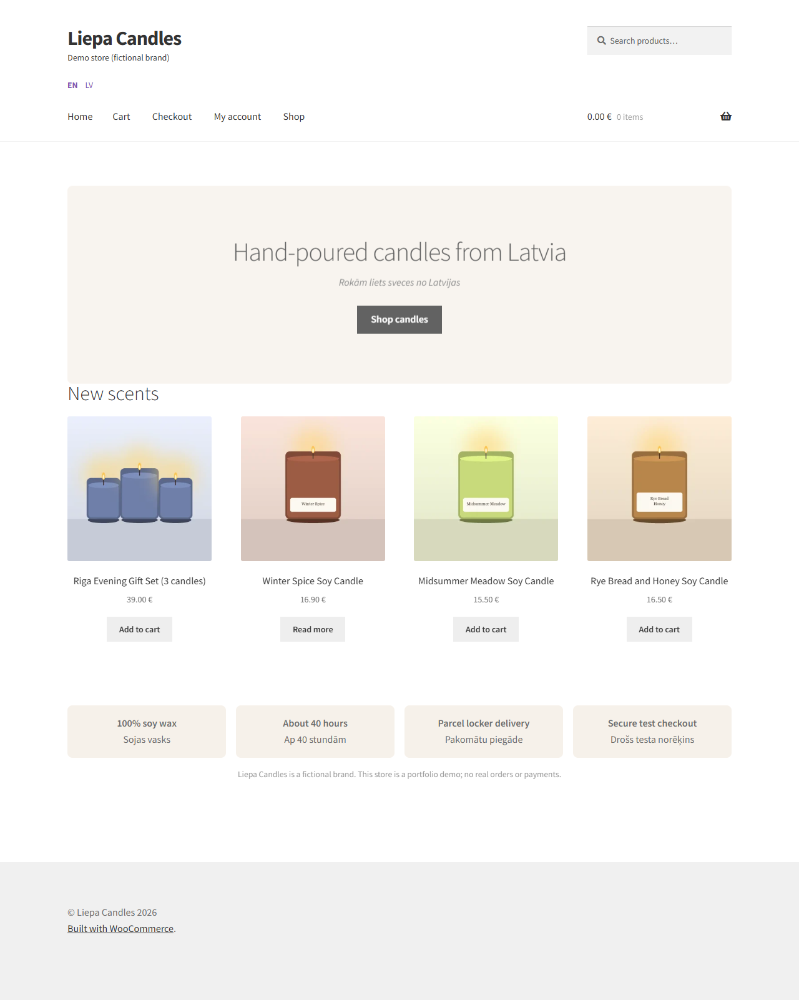
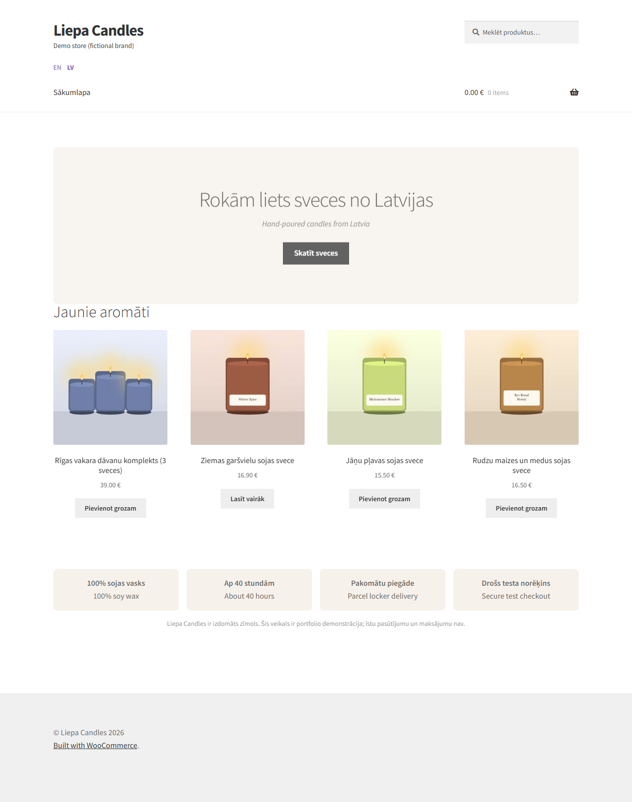
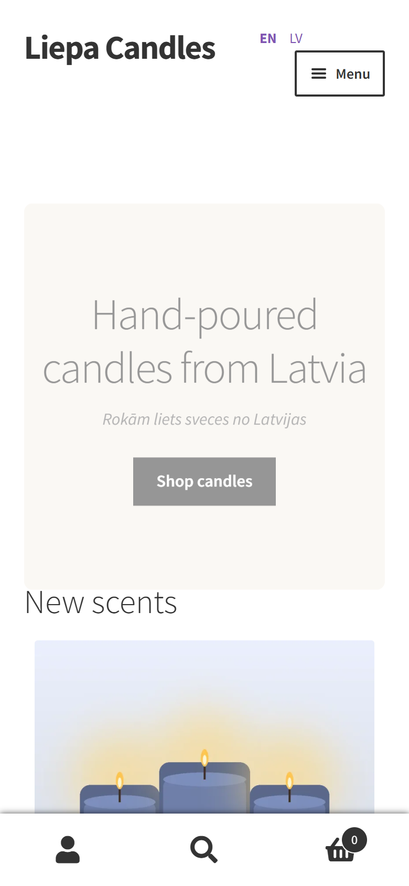
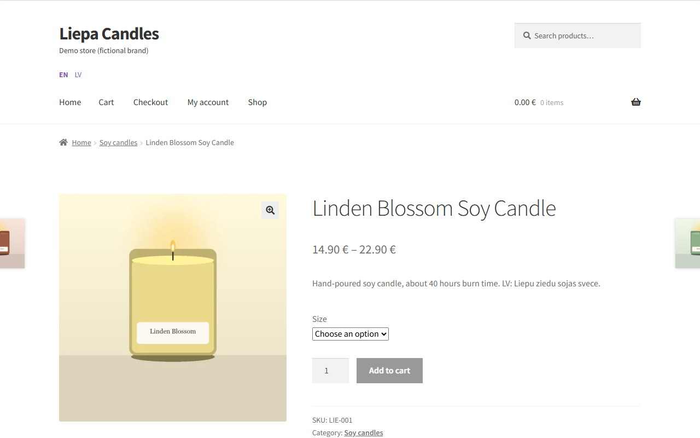

# Liepa Candles - WooCommerce demo store

A small, fast, bilingual (English / Latvian) online shop for a **fictional** Latvian candle brand, built with WordPress and WooCommerce.

> **This is a portfolio demo, not a real shop.** The brand, products and prices are made up, payments are test mode only, and nothing here is a copy of any real store.
> It was built as a learning project to practise WooCommerce development, speed work and testing. I have no previous professional WooCommerce or Shopify job experience, and this repository is meant to show how I work, not to claim it.

| Home (English) | Home (Latvian) | Phone |
|---|---|---|
|  |  |  |

| Product page | 3D view with AR button on phones |
|---|---|
|  |  |

## What the store has

- **8 candle products** with prices in EUR, stock, categories, and photos (illustrations drawn by a script, WebP, about 9 KB each).
- **Size choice** on one product (Small 150 g / Large 250 g) with a price per size.
- **3D view with AR** on a product page, using Google's `<model-viewer>`. The 140 KB model loads only when the viewer scrolls near the screen.
- **English and Latvian** with a header switcher (Polylang free).
- **Shipping for Latvia (demo rates):** parcel locker 2.99 EUR, courier 4.99 EUR, free over 35 EUR.
- **Coupon** `WELCOME10` (10 percent).
- **Security basics:** two-step login plugin, dashboard code editor off, no public sign-up, backup script.

## Speed (Lighthouse, mobile, median of three runs after)

| Page | Before | After |
|---|---|---|
| Home | 50 | **96** |
| Product (with 3D) | 42 | **83** |
| Shop | 81 | **83** |

The biggest gain came from a page cache; the pages were taking 1-8 seconds to build on every visit. Full table, the run-to-run spread and the open problems are in [docs/performance.md](docs/performance.md).

## Tests

- **11 automatic browser tests** (Playwright, using installed Chrome): home page, language switch, product sizes, 3D viewer loading lazily and really drawing the model, sold-out product, cart contents, coupon, shipping. All pass at the time of writing.
- **[Manual checklist](tests/manual-test-checklist.md)** for the parts that need a person: checkout with a test card, order e-mail, AR on a phone.
- **GitHub Actions** (`.github/workflows/lint.yml`) checks PHP syntax and JSON files. It has not run on GitHub yet because the repository has not been pushed.

Run the tests (the site must be started in Local first):

```powershell
cd tests
npm install
npm test
```

Testing found real bugs while I built this: the 3D model address was stored as `https://` so it failed on plain HTTP, and the 3D block was overlapping the product image. Both are fixed.

## Folder layout

| Folder | What is in it |
|---|---|
| `src/themes/liepa-child` | Child theme of Storefront: styles, language switcher, SEO description, translations loader |
| `src/plugins/liepa-3d-viewer` | Own plugin that adds the 3D / AR block to product pages |
| `src/content` | Home page content (English and Latvian) |
| `scripts/` | PowerShell and PHP scripts that set up and maintain the store (see below) |
| `assets/` | 3D model (with credits) and generated product images |
| `tests/` | Playwright tests and the manual checklist |
| `docs/` | Plan, performance results, plugin list, progress summary, screenshots |
| `tools/`, `sites/`, `backups/` | Local only (LocalWP, the WordPress site, backups); not in Git |

Each source file is small and does one thing; the plugin and theme `functions.php` files only load the others.

## Setup on Windows

Everything is installed in one project folder, so it can be moved or deleted as a whole. I have not tested these steps on a clean machine, only on the machine this was built on.

1. Install [Local](https://localwp.com) and create a site called `liepa-candles` (PHP 8.2, nginx, MySQL 8.4). Put the site files in `sites/`.
2. Install WooCommerce and the Storefront theme.
3. Link `src/plugins/liepa-3d-viewer` and `src/themes/liepa-child` into the site's `wp-content` (folder junctions) and activate them.
4. With the site running, run the scripts in this order:

| Script | What it does |
|---|---|
| `scripts/seed-products.ps1` | Creates the 8 products from `scripts/seed/products.json` |
| `scripts/images/generate_product_images.py`, then `scripts/import-product-images.ps1` | Draws the product pictures and sets them as photos |
| `scripts/create-home-page.ps1` | Publishes the home page |
| `scripts/setup-shop-features.ps1` | Shipping zone, coupon, size variants |
| `scripts/setup-languages.ps1` | English / Latvian (needs the Polylang plugin) |
| `scripts/setup-security.ps1`, `scripts/php/setup-cache.php` | 2FA plugin, hardening, page cache |
| `scripts/measure-lighthouse.ps1`, `scripts/backup.ps1`, `scripts/clear-cache.ps1` | Measure speed, back up, empty the cache |

`scripts/wp.ps1` runs WP-CLI against the local site and is used by the others.

## Plugins

WooCommerce, Polylang, WP Super Cache, Two Factor, and the own 3D viewer plugin. The reason for each one, and what was left out on purpose, is in [docs/plugins.md](docs/plugins.md).

## Known limits (honest list)

- **Payments are not set up yet.** The checkout cannot take a payment until a test-mode provider (Stripe or PayPal sandbox) is connected.
- **Language:** with free Polylang, cart, checkout and account pages exist only in English, and stock is not shared between an English product and its Latvian copy.
- **Speed:** the largest content on shop and product pages still takes about 3.5 s to appear in the simulated slow-phone test (web fonts and an icon font from the theme). The site runs on HTTP locally, which caps the best-practices score.
- **Not live:** the store runs only on my computer; there is no public web address or staging copy yet.
- **Content is fictional:** product names, descriptions and the Latvian texts are demo content.

## Credits

- 3D model "Glass Hurricane Candle Holder" by Eric Chadwick (Wayfair), from the Khronos glTF Sample Assets, CC BY 4.0. A compressed copy is used; see [assets/models/CREDITS.md](assets/models/CREDITS.md).
- WordPress, WooCommerce, Storefront, Polylang, WP Super Cache and Two Factor are free software from WordPress.org.
- Google `<model-viewer>`, Playwright and Lighthouse are open source.
